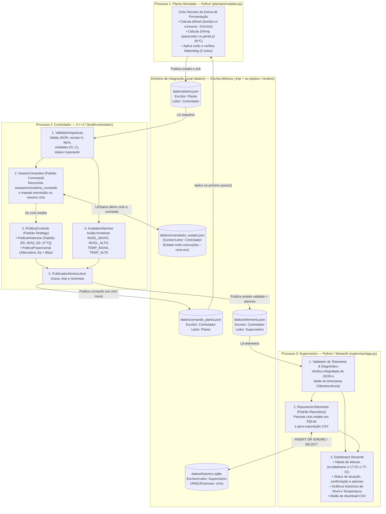
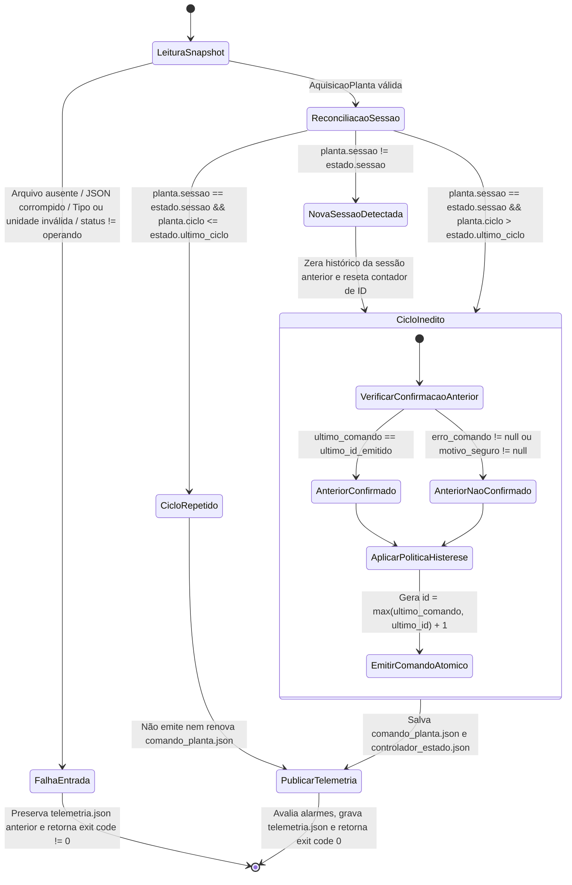

# Arquitetura do Sistema, Decisões de Engenharia e Análise de Trade-offs

> **Projeto Final — Programação Orientada a Objetos (2026/2)**  
> **Tema Escolhido**: Controle Termo-Hidráulico de Fermentador Cervejeiro (`LT-01` Nível de Mosto e `TT-01` Temperatura de Fermentação)  
> **Política Principal**: Controle por Histerese com Banda Morta (`PoliticaHisterese`) + Controle Proporcional (`PoliticaProporcional` para variação polimórfica `Strategy`)  
> **Padrões de Projeto Adotados**: `Strategy` + `Command` (Controlador C++) e `Repository` (Supervisório Python/SQLite)

---

## Sumário

1. [Especificação de 1 Página do Cenário Oficial (Marco de Arquitetura — Etapa 00)](#1-especificação-de-1-página-do-cenário-oficial-marco-de-arquitetura--etapa-00)
2. [Estudo Comparativo de Cenários de Automação (Ideias, Pontos Fortes, Perdas e Trade-offs)](#2-estudo-comparativo-de-cenários-de-automação-ideias-pontos-fortes-perdas-e-trade-offs)
3. [Políticas de Controle: Recomendações, Matemática, Pontos Fortes, Perdas e Trade-offs](#3-políticas-de-controle-recomendações-matemática-pontos-fortes-perdas-e-trade-offs)
4. [Padrões de Projeto (Design Patterns): Justificativa, Trade-offs e Alternativa Mais Simples](#4-padrões-de-projeto-design-patterns-justificativa-trade-offs-e-alternativa-mais-simples)
5. [Documentação Arquitetural em Diagramas Mermaid](#5-documentação-arquitetural-em-diagramas-mermaid)
6. [Guia de Fork, Branches e Fluxo de Trabalho por Etapa](#6-guia-de-fork-branches-e-fluxo-de-trabalho-por-etapa)

---

## 1. Especificação de 1 Página do Cenário Oficial (Marco de Arquitetura — Etapa 00)

Conforme exigido na Seção 2 do enunciado (*"Antes de implementar, registre em uma página: problema, grandezas, unidades, atuadores, objetivo de controle, estados, alarmes e limites da simulação"*), abaixo está a definição formal do recorte do projeto:

### 1.1. O Problema de Automação
Em uma microcervejaria automatizada, uma **dorna de fermentação contínua (biorreator cervejeiro)** recebe mosto nutritivo e mantém a cultura de leveduras (*Saccharomyces cerevisiae* — cepa *Kveik* de fermentação quente) em atividade metabólica. O processo sofre perdas contínuas de volume (extração/purga de amostras de `-1.0%/ciclo`) e dissipação térmica para o ambiente externo a `20 °C`, além de perturbações estocásticas. Sem controle automático, a dorna esvazia ou esfria até a dormência da levedura; com atuação excessiva, ocorre transbordo de espuma (*blow-off*) ou morte térmica celular.

### 1.2. Grandezas, Unidades e Sensores (Compatibilidade Total com `CONTRATO.md`)
| Tag | Tipo no JSON | Grandeza Física no Cenário | Unidade | Limites Físicos da Simulação | Ruído por Ciclo |
| :--- | :--- | :--- | :--- | :--- | :--- |
| **`LT-01`** | `"nivel"` | Volume / Nível útil de mosto no fermentador | `"%"` | `[0.0, 100.0]` (Inicial: `50.0%`) | Uniforme `[-0.2, +0.2] %` |
| **`TT-01`** | `"temperatura"` | Temperatura interna do mosto em fermentação | `"C"` | `[0.0, 100.0]` (Inicial: `25.0 °C`) | Uniforme `[-0.1, +0.1] °C` |

### 1.3. Atuadores e Equações da Planta (`planta/simulador.py`)
| Chave JSON | Equipamento Representado | Faixa de Comando | Efeito por Ciclo na Planta | Ponto de Equilíbrio ($\Delta = 0$) |
| :--- | :--- | :--- | :--- | :--- |
| **`bomba`** | Bomba Sanitária de Alimentação de Mosto | `0.0%` a `100.0%` | $\Delta N = 3.0 \cdot (\text{bomba}/100) - 1.0 + \text{ruído}$ | **`33.33%`** |
| **`aquecedor`** | Camisa Térmica de Aquecimento da Dorna | `0.0%` a `100.0%` | $\Delta T = 1.5 \cdot (\text{aquecedor}/100) - 0.04 \cdot (T - 20) + \text{ruído}$ | **`40.00%`** (a `35 °C`) |

### 1.4. Objetivo de Controle
1. **Malha de Nível (`LT-01`)**: Manter o nível de mosto dentro da **faixa operacional de histerese de `55.0%` a `65.0%`** (Setpoint central de `60.0%` na estratégia proporcional), garantindo espaço livre (*headspace* de `35%`) para a espuma da fermentação.
2. **Malha de Temperatura (`TT-01`)**: Manter a temperatura do mosto dentro da **janela metabólica de histerese de `33.0 °C` a `37.0 °C`** (Setpoint central de `35.0 °C` na estratégia proporcional).

### 1.5. Estados Operacionais do Sistema
- **`OPERANDO_NORMAL`**: Aquisição válida, ciclo inédito dentro da sessão atual, grandezas dentro das fronteiras de alarme e último comando confirmado pela planta.
- **`ATUACAO_EM_HISTERESE`**: Grandeza dentro da banda morta (`[55%, 65%]` ou `[33 °C, 37 °C]`), preservando o estado anterior do atuador sem chaveamento desnecessário.
- **`MODO_SEGURO_PLANTA`**: Planta reporta `motivo_seguro` igual a `"sem_arquivo"`, `"comando_invalido"` ou `"comando_expirado"` (após 5 ciclos sem novo `id` válido, a planta zera ambos os atuadores).
- **`FALHA_AQUISICAO` / `OBSOLETO`**: Arquivo ausente, JSON malformado, leitura com `status != "operando"` ou `timestamp` com idade superior ao limite de obsolescência (`5 segundos`).

### 1.6. Regras e Fronteiras Explícitas de Alarmes
| Código do Alarme | Severidade | Regra / Fronteira Explícita | Significado no Domínio Cervejeiro |
| :--- | :--- | :--- | :--- |
| **`NIVEL_BAIXO`** | `"aviso"` | `nivel < 25.0%` | Volume insuficiente na dorna; risco de cavitação e oxidação do mosto. |
| **`NIVEL_ALTO`** | `"critico"` | `nivel > 85.0%` | Invasão do *headspace*; risco iminente de transbordo de espuma (*blow-off*). |
| **`TEMP_BAIXA`** | `"aviso"` | `temperatura < 22.0 °C` | Resfriamento excessivo; risco de dormência/parada de fermentação (*stall*). |
| **`TEMP_ALTA`** | `"critico"` | `temperatura > 45.0 °C` | Superaquecimento crítico; produção de álcoois superiores (*fusel*) e lise celular. |

---

## 2. Estudo Comparativo de Cenários de Automação (Ideias, Pontos Fortes, Perdas e Trade-offs)

Durante a concepção arquitetural, avaliamos **5 cenários possíveis** frente às restrições da base fornecida (`planta/simulador.py`, `tests/test_controlador.py` e `tests/test_supervisor.py`):

### 2.1. Cenário 0: Tanque Termo-Hidráulico Genérico (Base Original)
- **Descrição**: Tanque industrial didático com controle de nível de água (`%`) e temperatura (`°C`) via bomba e aquecedor.
- **Pontos Fortes**:
  - Compatibilidade nativa imediata com 100% dos testes fornecidos pelo docente.
  - Nenhuma sobrecarga cognitiva de adaptação de domínio.
- **Perdas / Desvantagens**:
  - Ausência de contextualização industrial específica; apresentação idêntica à maioria das duplas da turma.
- **Trade-off**: Máxima simplicidade operacional em troca de menor diferenciação temática na defesa.

### 2.2. Cenário 1 (Escolhido): Fermentador Cervejeiro / Biorreator Automatizado
- **Descrição**: Dorna de fermentação controlada por nível de mosto (`LT-01`, `%`) e temperatura metabólica (`TT-01`, `C`), atuando sobre bomba de alimentação (`bomba`) e camisa térmica (`aquecedor`).
- **Pontos Fortes**:
  - **100% compatível com o contrato JSON e com os testes da CI**: preserva os nomes exatos `"LT-01"`, `"TT-01"`, `"nivel"`, `"temperatura"`, `"%"`, `"C"`, `"bomba"` e `"aquecedor"` exigidos em `tests/test_controlador.py` (linha 59) e `tests/test_supervisor.py` (linha 28).
  - Fornece uma justificativa física real e rigorosa para os **limites de alarme** (ex.: *headspace* de espuma acima de `85%` e morte térmica de leveduras acima de `45 °C`) e para a **Política de Histerese** (evitar ciclagem rápida da camisa térmica e da bomba sanitária).
- **Perdas / Desvantagens**:
  - A dinâmica continua sendo a aproximação linear discreta do simulador didático (sem modelar consumo de açúcar/densidade Plato).
- **Trade-off**: **Excelente equilíbrio entre identidade própria para a defesa oral e zero risco de quebrar os testes automatizados do repositório base.**

### 2.3. Cenário 2: Estufa Agrícola Inteligente / Hidroponia
- **Descrição**: Controle de umidade do substrato (`%`) e temperatura interna da estufa (`°C`) usando válvula de irrigação e aquecedor ambiental.
- **Pontos Fortes**:
  - Domínio intuitivo e fácil de visualizar; grandezas em `%` e `°C`.
- **Perdas / Desvantagens**:
  - Caso se altere o campo `tipo: "nivel"` para `"umidade"` ou `"bomba"` para `"valvula"`, os testes fornecidos em `tests/test_controlador.py` falham imediatamente, exigindo editar os testes de contrato e justificar no PR.
- **Trade-off**: Ganha-se apelo visual agrícola, mas assume-se atrito desnecessário com o validador de contrato padrão.

### 2.4. Cenário 3: Climatização de Data Center (Sala de Servidores CRAC)
- **Descrição**: Controle de temperatura dos racks (`°C`) e umidade relativa do ar (`%`) via Chiller de resfriamento e umidificador.
- **Pontos Fortes**:
  - Excelente aderência à área de Computação; permite discutir ação de controle reversa (resfriar quando esquenta).
- **Perdas / Desvantagens**:
  - Na equação de `planta/simulador.py` (`delta_temp = +1.5 * atuador/100 ...`), aumentar o atuador **eleva** a temperatura (aquecimento). Para simular um Chiller (resfriamento), seria obrigatório alterar o sinal da equação física na planta Python, quebrando `tests/test_planta.py`.
- **Trade-off**: Conceitualmente interessante, mas penalizado pelo acoplamento físico positivo do simulador fornecido.

### 2.5. Cenário 4: Reservatório Urbano com Dosagem de Cloro (Saneamento SCADA)
- **Descrição**: Controle de nível de reservatório (`%`) e concentração de cloro residual (`mg/L`) via bomba de recalque e bomba dosadora.
- **Pontos Fortes**:
  - Caso clássico de sistemas supervisórios SCADA reais.
- **Perdas / Desvantagens**:
  - A concentração de cloro opera na faixa de `0.2 a 2.0 mg/L`, incompatível com a escala `[0, 100]` e unidade `"C"` da segunda grandeza da planta original.
- **Trade-off**: Exige reescrever a simulação da segunda grandeza na planta Python e adaptar todos os fixtures de teste.

---

## 3. Políticas de Controle: Recomendações, Matemática, Pontos Fortes, Perdas e Trade-offs

O Requisito 3 da especificação determina:
> *"Implementar uma interface de política e **pelo menos duas estratégias de controle com comportamentos distintos e testáveis**. A equipe escolhe e justifica as estratégias; mudar apenas o nome de duas classes não caracteriza variação."*

Abaixo analisamos as opções de engenharia e detalhamos as duas estratégias selecionadas para o controlador C++ (`PoliticaHisterese` como principal e `PoliticaProporcional` como estratégia comparativa):

---

### 3.1. Estratégia 1 (Principal / Padrão): `PoliticaHisterese` (On-Off com Banda Morta)

#### Funcionamento e Regra Matemática
Diferente de um termostato simples com um único limiar (que ligaria e desligaria freneticamente a cada ciclo por causa do ruído de `±0.2%` e `±0.1 °C`), a **Política de Histerese** define uma **banda morta (zona neutra)** $[L_{\min}, L_{\max}]$ para cada grandeza e **memoriza o estado atual do atuador**:

- **Para o Nível de Mosto (`LT-01`, Banda `[55.0%, 65.0%]`)**:
  $$u_{\text{bomba}}(k) = \begin{cases} 100.0\% & \text{se } \text{nivel}(k) < 55.0\% \quad \text{(Enchimento ativo)} \\ 0.0\% & \text{se } \text{nivel}(k) > 65.0\% \quad \text{(Corte total)} \\ u_{\text{bomba}}(k-1) & \text{se } 55.0\% \le \text{nivel}(k) \le 65.0\% \quad \text{(Memória de histerese)} \end{cases}$$

- **Para a Temperatura de Fermentação (`TT-01`, Banda `[33.0 °C, 37.0 °C]`)**:
  $$u_{\text{aquecedor}}(k) = \begin{cases} 100.0\% & \text{se } T(k) < 33.0\,^\circ\text{C} \quad \text{(Aquecimento máximo)} \\ 0.0\% & \text{se } T(k) > 37.0\,^\circ\text{C} \quad \text{(Desligado — resfriamento natural)} \\ u_{\text{aquecedor}}(k-1) & \text{se } 33.0\,^\circ\text{C} \le T(k) \le 37.0\,^\circ\text{C} \quad \text{(Memória de histerese)} \end{cases}$$

#### Pontos Fortes
1. **Imunidade ao Ruído na Zona Neutra**: Pequenas oscilações pseudoaleatórias dentro da faixa `[55, 65]` ou `[33, 37]` não provocam novos chaveamentos.
2. **Demonstração Explicíta de Estado Encapsulado em POO**: A classe `PoliticaHisterese` precisa encapsular e preservar seu estado interno (`bomba_atual`, `aquecedor_atual`), cumprindo perfeitamente o requisito de testes de preservação de estado e fronteira (Seção 8 do PDF).
3. **Proteção Física de Atuadores**: Em plantas reais (bombas e contatores térmicos), reduz o desgaste mecânico por partida/parada.

#### Perdas / Desvantagens
1. **Oscilação Permanente (Ciclo Limite / Dente de Serra)**: A grandeza nunca estaciona em um número fixo; ela sobe até cruzar `65%`, cai até cruzar `55%` e repete o ciclo indefinidamente.
2. **Atuação nos Extremos (`0%` ou `100%`)**: Não modula potências intermediárias, podendo gerar leve *overshoot* (ultrapassagem momentânea da fronteira no ciclo seguinte).

#### Trade-off
Troca-se a **estabilização fina em um ponto único** pela **simplicidade mecânica, imunidade a ruído na banda morta e baixo número de comutações**.

---

### 3.2. Estratégia 2 (Comparativa Obrigatória): `PoliticaProporcional` (Controle P com Bias de Equilíbrio)

#### Funcionamento e Regra Matemática
Para garantir que a segunda estratégia do padrão `Strategy` tenha um comportamento **estruturalmente e matematicamente distinto** da Histerese, a `PoliticaProporcional` calcula uma atuação contínua graduada proporcional ao erro instantâneo ($e = \text{Setpoint} - \text{Medicao}$), somada à potência de equilíbrio físico da planta ($u_{\text{bias}}$):

- **Para o Nível (`Setpoint = 60.0%`, `Bias = 33.33%`, Ganho $K_{p,\text{nivel}} = 4.0$)**:
  $$u_{\text{bomba}}(k) = \text{clamp}\Big(33.33 + 4.0 \cdot \big(60.0 - \text{nivel}(k)\big),\; 0.0,\; 100.0\Big)$$

- **Para a Temperatura (`Setpoint = 35.0 °C`, `Bias = 40.0%`, Ganho $K_{p,\text{temp}} = 8.0$)**:
  $$u_{\text{aquecedor}}(k) = \text{clamp}\Big(40.0 + 8.0 \cdot \big(35.0 - T(k)\big),\; 0.0,\; 100.0\Big)$$

#### Pontos Fortes
1. **Convergência Suave sem Ciclo Limite**: Conforme o nível se aproxima de `60.0%` e a temperatura de `35.0 °C`, a atuação converge suavemente para o ponto de equilíbrio (`33.33%` e `40.0%`), mantendo a curva quase reta nos gráficos do Streamlit.
2. **Diferença Inquestionável nos Testes Unitários**:
   - Exemplo concreto para o teste autoral C++: para uma entrada `nivel = 58.0%` (vindo de estado inicial desligado), a `PoliticaHisterese` decide **`0.0%`** (pois `58%` está dentro da banda morta `[55, 65]`), enquanto a `PoliticaProporcional` decide **`41.33%`** ($33.33 + 4.0 \times 2.0$).

#### Perdas / Desvantagens
1. **Sensibilidade Contínua ao Ruído**: Cada variação de `0.1%` no ruído da planta altera ligeiramente o percentual enviado ao atuador.
2. **Erro Estacionário (*Offset*)**: Se o setpoint for alterado para longe do ponto onde o *bias* foi calibrado, resta um pequeno erro residual constante.

#### Trade-off
Troca-se a **tranquilidade de chaveamento da Histerese** pela **precisão contínua e ausência de grandes oscilações**, exigindo um atuador capaz de modular potência fracionada (`0..100%`).

---

### 3.3. Outras Políticas Avaliadas e Por Que Foram Preteridas

| Política Candidata | Como Funciona | Pontos Fortes | Perdas / Por que foi preterida |
| :--- | :--- | :--- | :--- |
| **Controle Escalonado por Zonas (Multi-Estágio)** | Tabela de 4 faixas fixas (`0%`, `35%`, `70%`, `100%`). | Fácil leitura visual. | Matematicamente é apenas uma discretização grosseira do controlador Proporcional; menos elegante de contrastar com o On-Off do que a lei Proporcional contínua. |
| **Controle PI Discreto (Proporcional-Integral)** | Soma um acumulador de erro $\sum e_k \Delta t$ ao termo proporcional. | Elimina 100% do erro estacionário para qualquer setpoint. | Como o controlador roda em modo `--uma-vez` (processo efêmero chamado a cada ciclo nos testes), exigir persistência do acumulador integral com *anti-windup* adiciona complexidade extra sem ganho na nota em relação ao par Histerese + Proporcional. |

---

## 4. Padrões de Projeto (Design Patterns): Justificativa, Trade-offs e Alternativa Mais Simples

Na Seção 4 e 5 da especificação, é exigido implementar **ao menos dois padrões com necessidade demonstrada** e saber explicar na defesa: **o problema resolvido, as classes participantes, os testes e uma alternativa mais simples**.

Adotamos **3 padrões complementares** (2 no C++ e 1 no Python):

---

### 4.1. Padrão 1: `Strategy` (Políticas de Controle em C++)

- **Problema Resolvido**:
  O controlador precisa aplicar diferentes leis de controle (`PoliticaHisterese` vs. `PoliticaProporcional`) sobre a mesma aquisição validada. Colocar ambas as lógicas dentro da classe `Controlador` usando condicionais (`if/else` ou `switch`) acoplaria parâmetros distintos (limites de banda morta e memória de estado vs. ganhos $K_p$ e *bias*) e impediria testar ou estender cada política de forma isolada.
- **Classes Participantes**:
  - `IPoliticaControle` (`controlador/politica_controle.hpp`): Interface abstrata pura (`virtual DecisaoAtuacao calcular(const AquisicaoPlanta& aq) = 0;`).
  - `PoliticaHisterese`: Implementação concreta com estado interno de memória da banda morta.
  - `PoliticaProporcional`: Implementação concreta baseada em ganho proporcional, *bias* e saturação.
  - `Controlador`: Contexto que recebe e delega a decisão a uma instância polimórfica de `IPoliticaControle`.
- **Pontos Fortes**:
  - Isolamento completo do estado e das invariantes de cada algoritmo.
  - Permite instanciar `PoliticaHisterese` e `PoliticaProporcional` lado a lado no mesmo teste unitário C++ (`tests/cpp/autorais_controle.cpp`), passar a mesma `AquisicaoPlanta` determinística e provar que produzem atuações diferentes sem tocar em arquivos ou Streamlit.
- **Perdas / Trade-offs**:
  - Aumenta o número de arquivos/classes e adiciona despacho dinâmico (`vtable`). Troca-se compacidade inicial por **testabilidade unitária pura e aderência ao Princípio Aberto/Fechado (OCP)**.
- **Alternativa Mais Simples (Para a Defesa)**:
  - Uma função livre `calcularAtuacao(aquisicao, modo_enum)` com um `switch (modo)`. Essa abordagem seria mais curta, mas obrigaria a função a receber todos os parâmetros de todas as políticas possíveis e manter variáveis estáticas ou globais para lembrar o estado anterior da histerese.

---

### 4.2. Padrão 2: `Command` (Solicitação, Identidade e Confirmação de Atuação em C++)

- **Problema Resolvido**:
  No contrato (`docs/CONTRATO.md`), gravar `comando_planta.json` não significa que a planta aplicou a atuação. Cada comando precisa de um `id` inteiro positivo crescente por `sessao`, não pode ser renovado/reemitido se o controlador reler o mesmo `ciclo` (inclusive em chamadas separadas `--uma-vez`), precisa ter sua confirmação verificada no campo `ultimo_comando` do ciclo seguinte e deve ser reconciliado caso a planta reinicie (nova `sessao`) ou entre em modo seguro (`comando_expirado`).
- **Classes Participantes**:
  - `ComandoAtuacao` (`controlador/comando_atuacao.hpp`): Objeto *Command* que encapsula os dados e invariantes da ordem de atuação (`versao = 1`, `sessao`, `id`, `bomba`, `aquecedor`), valida que os percentuais são finitos em `[0, 100]` e serializa para o formato JSON exato do contrato.
  - `GestorComandos`: Responsável pelo ciclo de vida do comando — persiste e recupera o último `(sessao, ciclo, id)` em `dados/controlador_estado.json`, impede emissão duplicada no mesmo ciclo e verifica se a aquisição atual confirmou o último comando emitido.
- **Pontos Fortes**:
  - Transforma o pedido de atuação em um objeto verificável e auditável em memória antes de qualquer escrita em disco.
  - Garante aprovação direta nos testes de contrato `test_comando_aplicado_no_proximo_ciclo` e `test_mesmo_ciclo_nao_gera_novo_comando`.
- **Perdas / Limitações**:
  - Conforme destacado no PDF, o padrão `Command` modela a solicitação e seu rastreio, mas **não garante sozinho que o processo receptor leu o arquivo** — por isso ele colabora obrigatoriamente com a verificação de `ultimo_comando` na leitura seguinte.
- **Alternativa Mais Simples (Para a Defesa)**:
  - Montar uma string/JSON diretamente no fim do loop de controle somando `ultimo_comando + 1`. Essa alternativa falha quando o controlador é executado duas vezes no mesmo ciclo (`--uma-vez`), pois sem o gestor de estado do comando ele geraria um novo comando ou sobrescreveria o arquivo indevidamente.

---

### 4.3. Padrão 3: `Repository` (Persistência SQLite e Deduplicação no Supervisório Python)

- **Problema Resolvido**:
  O Streamlit executa todo o script Python de cima a baixo a cada interação do usuário ou atualização automática da página (*rerun*). Se o supervisório simplesmente fizer um `INSERT` no SQLite toda vez que ler `telemetria.json`, o mesmo ciclo será gravado dezenas de vezes no banco de dados (violando o Requisito 9: *"Persistir histórico em SQLite, deduplicado por sessão/ciclo, e oferecer exportação CSV. Atualizações da tela não podem duplicar registros"*). Além disso, a persistência precisa ser testada por `unittest` sem abrir o servidor web do Streamlit.
- **Classes Participantes**:
  - `RepositorioTelemetria` (`supervisor/repositorio.py`): Encapsula toda a interação com `sqlite3`. Cria a tabela `historico_telemetria` com restrição `UNIQUE(sessao, ciclo)`, expõe os métodos `registrar_telemetria(documento_json) -> bool`, `listar_historico(sessao=None, limite=200) -> list[dict]` e `exportar_csv(sessao=None) -> str`.
- **Pontos Fortes**:
  - **Desacoplamento total entre UI e Banco**: `supervisor/app.py` apenas chama métodos de alto nível do repositório.
  - **Testabilidade 100% determinística**: Em `tests/autorais_supervisor.py`, instanciamos `RepositorioTelemetria` apontando para um arquivo SQLite temporário (`tempfile`), inserimos duas vezes o mesmo `(sessao, ciclo)` e provamos com `assertEqual(len(historico), 1)` que não há duplicação.
- **Perdas / Trade-offs**:
  - Exige definir um schema relacional claro e converter entre o formato aninhado do JSON (`leituras: [...]`, `atuadores: {...}`, `alarmes: [...]`) e colunas tabulares do SQLite.
- **Alternativa Mais Simples (Para a Defesa)**:
  - Manter uma lista em `st.session_state` ou gravar linhas diretamente em um arquivo `.csv` via `open(..., "a")` dentro de `app.py`. Essa alternativa perderia dados ao fechar a aba do navegador ou duplicaria linhas quando múltiplos *reruns* lessem o mesmo snapshot.

---

### 4.4. Avaliação do Padrão `Observer` (Por que não o usamos como padrão primário)

- **Análise**: O padrão `Observer` permite que um sujeito (ex.: `MonitorPlanta`) notifique uma lista dinâmica de observadores quando o estado muda.
- **Ponto Forte**: Desacopla múltiplos consumidores em sistemas orientados a eventos em memória.
- **Perda / Limitação neste Projeto**: O controlador C++ é executado de forma síncrona por snapshot (especialmente com a flag `--uma-vez` exigida pela suíte de testes, onde o processo nasce, lê `planta.json`, grava `comando_planta.json` e `telemetria.json`, e morre). Criar uma infraestrutura de assinatura/notificação (`subscribe`/`notify`) para um pipeline linear de um único ciclo adiciona complexidade acidental e risco de duplicar alarmes sem necessidade real.
- **Decisão de Engenharia**: Usar composição direta com `AvaliadorAlarmes` e concentrar os padrões em **`Strategy` + `Command` + `Repository`**, onde cada padrão resolve um requisito real e testável do contrato.

---

## 5. Documentação Arquitetural em Diagramas Mermaid

### 5.1. Diagrama de Arquitetura de Processos e Troca de Snapshots JSON



---

### 5.2. Diagrama de Classes UML (Controlador C++ e Supervisório Python)

```mermaid
classDiagram
    direction TB

    class Leitura {
        +string tag
        +string tipo
        +double valor
        +string unidade
        +string status
        +ehValida() bool
    }

    class AquisicaoPlanta {
        +int versao
        +string sessao
        +int ciclo
        +string timestamp
        +vector~Leitura~ leituras
        +double bomba_aplicada
        +double aquecedor_aplicado
        +int ultimo_comando
        +optional~string~ erro_comando
        +optional~string~ motivo_seguro
        +nivel() double
        +temperatura() double
    }

    class ValidadorAquisicao {
        +parsearEValidar(conteudo_json: string) optional~AquisicaoPlanta~
        +verificarObsolescencia(timestamp_utc: string, max_segundos: int) bool
    }

    class DecisaoAtuacao {
        +double bomba
        +double aquecedor
    }

    class IPoliticaControle {
        <<interface>>
        +calcular(aquisicao: AquisicaoPlanta)* DecisaoAtuacao
        +nome()* string
    }

    class PoliticaHisterese {
        -double nivel_min
        -double nivel_max
        -double temp_min
        -double temp_max
        -double estado_bomba
        -double estado_aquecedor
        +calcular(aquisicao: AquisicaoPlanta) DecisaoAtuacao
        +definirEstadoInicial(bomba: double, aquecedor: double) void
        +nome() string
    }

    class PoliticaProporcional {
        -double setpoint_nivel
        -double setpoint_temp
        -double kp_nivel
        -double kp_temp
        -double bias_bomba
        -double bias_aquecedor
        +calcular(aquisicao: AquisicaoPlanta) DecisaoAtuacao
        +nome() string
    }

    class ComandoAtuacao {
        -int versao
        -string sessao
        -int id
        -double bomba
        -double aquecedor
        +id() int
        +sessao() string
        +bomba() double
        +aquecedor() double
        +paraJson() string
    }

    class EstadoControlador {
        +string sessao
        +int ultimo_ciclo_processado
        +int ultimo_id_emitido
        +bool comando_confirmado
        +double ultima_bomba_histerese
        +double ultimo_aquecedor_histerese
    }

    class GestorComandos {
        -EstadoControlador estado
        +carregar(caminho_arquivo: string) bool
        +salvarAtomico(caminho_arquivo: string) bool
        +jaProcessouCiclo(sessao: string, ciclo: int) bool
        +reconciliarSessaoEConfirmacao(aquisicao: AquisicaoPlanta) void
        +criarNovoComando(aquisicao: AquisicaoPlanta, decisao: DecisaoAtuacao) ComandoAtuacao
    }

    class Alarme {
        +string codigo
        +string mensagem
        +string severidade
    }

    class AvaliadorAlarmes {
        -double nivel_baixo
        -double nivel_alto
        -double temp_baixa
        -double temp_alta
        +avaliar(aquisicao: AquisicaoPlanta) vector~Alarme~
    }

    class Controlador {
        -unique_ptr~IPoliticaControle~ politica
        -ValidadorAquisicao validador
        -GestorComandos gestor_comandos
        -AvaliadorAlarmes avaliador_alarmes
        +executarCiclo(dir_dados: string) int
        +definirPolitica(nova_politica: unique_ptr~IPoliticaControle~) void
    }

    class RepositorioTelemetria {
        -Path caminho_banco
        +inicializar() void
        +salvar_telemetria(doc: dict) bool
        +listar_historico(sessao: str, limite: int) list~dict~
        +exportar_csv(sessao: str) str
    }

    AquisicaoPlanta *-- Leitura
    IPoliticaControle <|.. PoliticaHisterese : Strategy (Principal)
    IPoliticaControle <|.. PoliticaProporcional : Strategy (Alternativa)
    IPoliticaControle ..> DecisaoAtuacao : produz
    GestorComandos *-- EstadoControlador : persiste
    GestorComandos ..> ComandoAtuacao : instancia (Command)
    AvaliadorAlarmes ..> Alarme : produz
    Controlador *-- IPoliticaControle
    Controlador *-- ValidadorAquisicao
    Controlador *-- GestorComandos
    Controlador *-- AvaliadorAlarmes
    Controlador ..> AquisicaoPlanta : consome
```



---

### 5.3. Diagrama de Sequência: Ciclo Completo, Idempotência (`--uma-vez`) e Deduplicação SQLite

```mermaid
sequenceDiagram
    autonumber
    participant P as Planta (simulador.py)
    participant D as Arquivos (dados/)
    participant C as Controlador C++
    participant S as Supervisório (app.py)
    participant R as RepositorioTelemetria (SQLite)

    Note over P,D: 1. Planta executa passo() do Ciclo 1 e grava snapshot atômico
    P->>D: os.replace -> dados/planta.json (sessao="S1", ciclo=1, LT-01=49.1%, TT-01=24.8C, ultimo_comando=0)

    Note over C,D: 2. Primeira execução do Controlador (--dados dados --uma-vez)
    C->>D: Lê dados/planta.json e dados/controlador_estado.json
    C->>C: ValidadorAquisicao aprova envelope, tipos, unidades e status
    C->>C: GestorComandos detecta ciclo inédito (ciclo 1 > 0)
    C->>C: PoliticaHisterese calcula atuação (LT-01 < 55% -> bomba=100%; TT-01 < 33C -> aquecedor=100%)
    C->>C: AvaliadorAlarmes verifica fronteiras ([25..85%], [22..45C]) -> sem alarmes
    C->>D: Escrita atômica -> dados/comando_planta.json (id=1, bomba=100, aquecedor=100)
    C->>D: Escrita atômica -> dados/telemetria.json (ciclo=1, alarmes=[])
    C->>D: Escrita atômica -> dados/controlador_estado.json (sessao="S1", ultimo_ciclo=1, ultimo_id=1)

    Note over C,D: 3. Segunda execução do Controlador no MESMO Ciclo 1 (Teste de Idempotência)
    C->>D: Lê dados/planta.json (ainda ciclo=1) e dados/controlador_estado.json (ultimo_ciclo=1)
    C->>C: GestorComandos detecta (sessao=="S1" e ciclo==1) -> NÃO gera novo comando!
    C->>D: Mantém comando_planta.json (id=1) intacto e retorna exit code 0

    Note over P,D: 4. Próximo passo() da Planta (Ciclo 2) aplica comando e confirma ID
    P->>D: Lê dados/comando_planta.json (id=1)
    P->>D: Publica dados/planta.json (sessao="S1", ciclo=2, ultimo_comando=1, atuadores={100, 100})

    Note over S,R: 5. Supervisório lê telemetria e evita duplicação em múltiplos reruns
    S->>D: Lê dados/telemetria.json (sessao="S1", ciclo=1)
    S->>R: salvar_telemetria(sessao="S1", ciclo=1)
    R-->>S: True (Inserido no SQLite)
    S->>S: Usuário atualiza a tela (Streamlit rerun no mesmo ciclo=1)
    S->>R: salvar_telemetria(sessao="S1", ciclo=1)
    R-->>S: False (Ignorado por UNIQUE(sessao, ciclo) — zero duplicação!)
```

---

### 5.4. Máquina de Estados da Aquisição e Ciclo de Vida do Comando



---

## 6. Guia de Fork, Branches e Fluxo de Trabalho por Etapa

Conforme a Seção 7 do PDF e o workflow `.github/workflows/testes.yml`:

1. **Configuração de Remotes**:
   - Cada integrante trabalha em seu fork mantendo **somente o remote `origin`** apontando para o próprio fork (nunca configurar `upstream` e nunca abrir PR para o repositório do professor).
2. **Sequência de Branches e Validações Cumulativas**:
   - **`projeto/00-ambiente`** (`ETAPA_ATUAL = 00`):
     - Validação: `make test ETAPA=00`
     - Entregável: Ambiente configurado, documento de arquitetura e cenário (`docs/ARQUITETURA_E_DECISOES.md`).
   - **`projeto/01-aquisicao`** (`ETAPA_ATUAL = 01`):
     - Validação: `make test ETAPA=01`
     - Entregável: Leitura e validação de `planta.json` em C++, recusa de JSON inválido/ausente sem sobrescrever `telemetria.json`, avaliação de alarmes, geração atômica de `telemetria.json` e testes autorais em `tests/cpp/autorais_aquisicao.cpp`.
   - **`projeto/02-controle`** (`ETAPA_ATUAL = 02`):
     - Validação: `make test ETAPA=02`
     - Entregável: Padrão `Strategy` (`IPoliticaControle`, `PoliticaHisterese`, `PoliticaProporcional`), Padrão `Command` (`ComandoAtuacao`, `GestorComandos` com `controlador_estado.json`), geração de `comando_planta.json` sem renovar no mesmo ciclo e testes em `tests/cpp/autorais_controle.cpp`.
   - **`projeto/03-supervisor`** (`ETAPA_ATUAL = 03`):
     - Validação: `make test ETAPA=03`
     - Entregável: Padrão `Repository` (`RepositorioTelemetria` com SQLite deduplicado por `sessao/ciclo` e exportação CSV), painel Streamlit completo (`supervisor/app.py`) passando no `AppTest` e testes autorais em `tests/autorais_supervisor.py`.
   - **`projeto/04-entrega`** (`ETAPA_ATUAL = 03`):
     - Validação: `make test ETAPA=03` e `make cobertura ETAPA=03`
     - Entregável: Relatórios de cobertura analisados, matriz completa de testes no `README.md`, `AI_LOG.md` revisado e roteiro de demonstração final.
